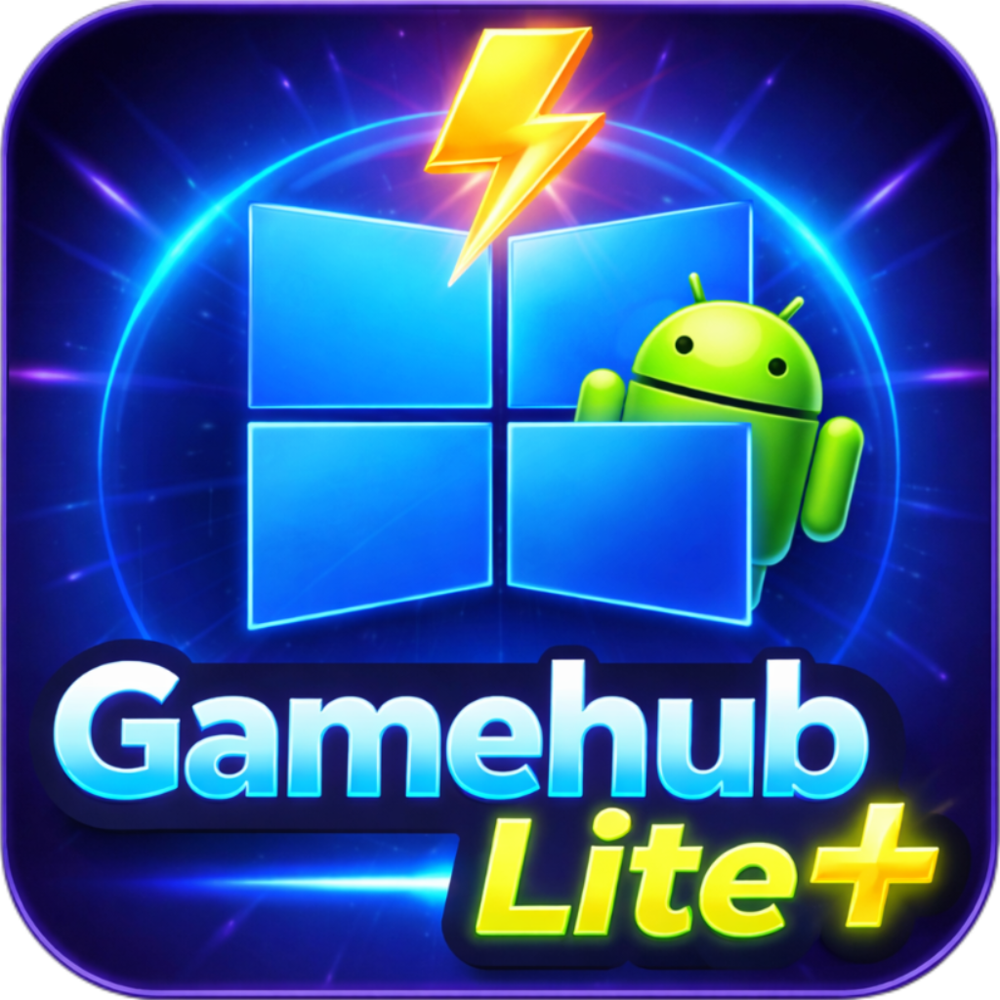

  

  
  
  
  
  

<h1 align="center">GameHubLite-Plus</h1>

🔥 <b>GameHubLite Plus (GHLP)</b> repousse les limites matérielles et franchit les barrières entre PC et smartphone (<b>SANS ROOT</b>), pour des performances maximales lors de vos sessions de jeu prolongées.

---

## 📑 Sommaire

- [Présentation](#présentation)
- [Avertissement important](#avertissement-important)
- [Configurations système](#configurations-système)
- [Versions disponibles](#versions-disponibles)
- [Fonctionnalités exclusives](#fonctionnalités-exclusives)
  - [GHLP Cores](#ghlp-cores)
  - [Opti'Frame Generation](#optiframe-generation)
  - [Gestionnaire de composants](#gestionnaire-de-composants)
  - [Support natif des optimiseurs Android](#support-natif-des-optimiseurs-android)
- [FAQ](#faq)
- [Téléchargement](#téléchargement)
- [Contenu du dépôt](#contenu-du-dépôt)
- [Propriété intellectuelle, crédits et avertissement légal](#propriété-intellectuelle-crédits-et-avertissement-légal)

---

## 🧭 Présentation

GHLP hérite de tous les avantages de [GameHub Lite](https://github.com/Producdevity/gamehub-lite/releases) par rapport à l'application originale :

* 🚫 **Zéro télémétrie :** suppression de 11 838 fichiers de tracking.
* 🔒 **Confidentialité et liberté :** suppression des 31 permissions invasives, aucun login obligatoire, fonctionnement 100 % hors ligne.
* 🪶 **Poids plume :** taille de l'APK réduite de 114 Mo à environ 50 Mo.

**Performances et stabilité :** GHLP repose sur un moteur de reconnaissance native propriétaire et une allocation dynamique des ressources CPU/GPU/RAM. Résultat : moins de saccades, une meilleure tenue des fréquences dans la durée, et une stabilité qui se maintient même lors de sessions de jeu prolongées.

---

## ⚠️ Avertissement important

> **TOUTE UTILISATION SANS LA CONFIGURATION MINIMALE REQUISE PEUT ENTRAÎNER UNE DÉTÉRIORATION DU MATÉRIEL (surchauffe batterie / SoC / écran).**

### 🧠 Configurations système

| Composant | 🟢 Minimale | 🔵 Recommandée |
| :--- | :--- | :--- |
| **Système d'exploitation** | Android 14 | Android 15 |
| **Processeur (SoC)** | Snapdragon 870 | Snapdragon 8 Gen 3 |
| **Puce graphique (GPU)** | Adreno 650 | Adreno 740 |
| **Mémoire vive (RAM)** | 12 Go LPDDR5 | 16 Go LPDDR5X |
| **Stockage interne** | UFS 3.1 | UFS 4.0 |
| **Refroidissement** | Refroidisseur externe 20 W | Refroidisseur externe 30 W + plaque de dissipation thermique |

---

## 📦 Versions disponibles

GameHubLite Plus est proposé en trois déclinaisons pour s'adapter au mieux à votre appareil :

* 🌍 **Version Globale :** compatible avec tout appareil respectant au moins la configuration minimale requise.
* 🌡️ **Version AnTuTu :** identique à la version Globale, à ceci près que le nom du package `com.antutu.ABenchMark` a été remplacé, ce qui permet au matériel de lever ses limitations et d'améliorer les résultats d'un benchmark.
* 🎮 **Version REDMAGIC :** exclusivement optimisée pour les appareils REDMAGIC. Débloque le plein potentiel du matériel via l'**AI Frame Generation**, la **Super Resolution** et des optimisations exclusives au système.

---

## ➕ Fonctionnalités exclusives à GHLP

* 🇫🇷 **Interface :** traduite en français à 95 %.
* 📝 **Correction :** résolution de la régression des performances (GH 5.3.X).
* 🚀 **VRAM étendue :** augmentation de la limite de VRAM allouée (6, 8, 12 et 16 Go).
* 🎮 **Boutique en ligne :** accès direct à la bibliothèque Epic Games Store.
* ⚡ **Architecture UMA :** configuration universelle optimisée pour la traduction de DirectX 11/12 en appels Vulkan, afin d'exploiter pleinement le SoC et l'architecture à mémoire unifiée.
* 🪫 **Énergie :** exclusion possible des optimisations batterie restrictives d'Android.

### [🎯 GHLP Cores : reconnaissance native AAA](https://spetnaz971.github.io/GameHubLite-Plus/GHLP_Cores_by-SpetNaz971.html)

Android traite **nativement** GHLP comme un jeu vidéo AAA :

* **Détection intelligente :** reconnaissance automatique des moteurs de jeu (Unity, Unreal, DirectX, VKD3D-PROTON) pour des profils de performance optimisés.
* **Ressources débridées :** optimisation de l'allocation CPU/GPU/RAM pour maintenir des fréquences stables et empêcher le *thermal throttling*.
* **Priorité native :** appliquée aux threads exécutés dynamiquement.
* **Liberté de framerate :** empêche Android d'imposer sa propre limite de FPS par-dessus l'environnement Wine-Proton.
* **Cadencement fluide :** micro-ajustements dynamiques continus réduisant les saccades et la latence.
* **Efficacité énergétique :** optimisation de la consommation de la batterie et prolongation des sessions de jeu.

### 🖼️ Opti'Frame Generation

* **6 préréglages disponibles :** ECO / FLOW / BAL (par défaut) / BOOST / CLEAR / MAX.
* La sélection d'un préréglage charge automatiquement les valeurs de *flowScale* et du modèle d'IA.
* Les profils **ECO/FLOW/BAL/BOOST** utilisent le modèle *Standard* (plus économique).
* Les profils **CLEAR/MAX** utilisent le modèle *Clear* (traitement du flux optique plus intensif, moins d'images fantômes).

> ⚠️ **Snapdragon recommandé :** cette option peut apparaître sur des appareils non Adreno, mais la qualité de génération et les performances varient selon le pilote.

> 🧪 **Précision :** ce n'est pas l'AI FrameGen de GameHub. **Opti'FrameGen est une implémentation propre à GameHubLite Plus**, développée par [SpetNaz971](https://github.com/Spetnaz971) et pensée pour une génération d'images de niveau PC, optimisée pour ARM.

### 🧰 Gestionnaire de composants

*(Accessible via le menu de gauche → Composants)*

Contrôle total sur les composants utilisés par GHLP : injection ou suppression à la volée de DXVK, VKD3D-PROTON, Box64, FEXCore et des pilotes GPU (visibles dans les paramètres par jeu).

🔗 **5 sources intégrées pour télécharger composants et pilotes :**
* [Arihany WCPHub](https://github.com/Arihany/WinlatorWCPHub?tab=readme-ov-file)
* [Pilotes GPU Whitebelyash](https://github.com/whitebelyash/freedreno_turnip-CI/releases)
* [Pilotes GPU StevenMXZ](https://github.com/StevenMXZ/Adreno-Tools-Drivers/releases)
* [Pilotes GPU K11MCHI](https://github.com/K11MCH1/AdrenoToolsDrivers/releases/)
* Pilotes GPU MTR

### 👾 Support natif des optimiseurs Android

GHLP est reconnu et pris en charge par les systèmes suivants :
* RedMagic GameBooster
* Samsung Game Booster (GOS)
* Xiaomi Game Turbo
* OPPO/Realme HyperBoost
* Qualcomm Snapdragon Game Space
* MediaTek DuraSpeed

---

<b>💬 Foire aux questions (FAQ)</b>

 

### 🏷️ Pourquoi ce nom « GameHubLite Plus » ?
J'ai volontairement ajouté uniquement le mot **« Plus »** au nom du projet, car il s'agit d'un fork. Je respecte énormément le travail de l'équipe originale de GameHub Lite, dont j'utilise d'ailleurs l'API officielle.

### 💰 Est-ce que GHLP est gratuit ?
**Oui, totalement.** 👍🏾 Le projet est 100 % gratuit. Seuls les jeux que vous possédez (achetés sur Steam, Epic Games Store, etc.) restent à votre charge, via les plateformes officielles.

### 🔄 Quelle est la différence avec GH, GHL, etc. ?
La différence se joue principalement sur trois axes, détaillés plus haut : la localisation FR à 95 %, le moteur exclusif [**GHLP Cores**](#ghlp-cores) (détection native des moteurs, gestion thermique et priorité des threads optimisées) et [**Opti'FrameGen**](#optiframe-generation), notre implémentation propre de génération d'images optimisée pour ARM. S'y ajoute une configuration universelle préoptimisée, fortement recommandée sur Snapdragon.

### 🎚️ Un smartphone avec 6/8 Go de RAM + RAM étendue (virtuelle) est-il suffisant ?
**Nuance importante :** la **RAM virtuelle** n'est pas aussi rapide que la **RAM réelle**. Dans un environnement aussi lourd que celui de GHLP (Wine, FEX, Proton, DXVK, etc.), en abuser peut même s'avérer **contre-productif**.

* **Un simple filet de sécurité :** la RAM virtuelle n'est exploitée nativement que par le système d'exploitation, afin d'éviter le plantage des applications basiques en arrière-plan.
* **Le mythe des constructeurs :** la RAM virtuelle ne fait pas gagner en performances ; c'est un argument marketing répandu par ignorance.

> ⚠️ **Pas de miracle :** même avec toute la RAM virtuelle du monde, le moteur GHLP Cores ne pourra rien faire si votre configuration matérielle réelle ne respecte pas la configuration minimale requise.

### 📥 Où puis-je télécharger GameHubLite Plus ?
Voir la section [Téléchargement](#téléchargement) ci-dessous.

---

## 📥 Téléchargement

GameHubLite Plus est distribué via notre serveur Discord officiel, accessible depuis le [site du projet](https://spetnaz971.github.io/GameHubLite-Plus/).

Le code source de l'application est communicable sur demande via ce même Discord, dans les conditions décrites dans le fichier [`LICENSE`](LICENSE) (section 4).

---

## 📁 Contenu du dépôt

| Fichier / Dossier | Description |
| :--- | :--- |
| `index.html` | Page d'accueil du site du projet, servie via GitHub Pages ([spetnaz971.github.io/GameHubLite-Plus](https://spetnaz971.github.io/GameHubLite-Plus/)) |
| `docs/HTML` | Documentation HTML complémentaire (pages de présentation détaillées du projet) |
| `assets/images` | Ressources visuelles utilisées par le site et la documentation (captures d'écran, icônes, illustrations) |
| `README.md` | Documentation principale du projet |
| [`LICENSE`](LICENSE) | Licence propriétaire — Tous droits réservés (GHLP Cores, Opti'FrameGen), composants tiers sous licences d'origine, conditions d'accès au code source sur demande |
| `Logo_GHL+_v3.png` | Bannière/logo du projet |
| `GHLP_Cores_by-SpetNaz971.html` | Page de présentation détaillée du moteur GHLP Cores |

---

<b>ℹ️ Informations relatives à l'IA</b>

 

Le code des extensions étant développé par une seule personne, les modèles Opus 5.5 et DeepSeek 4.1 Pro sont sollicités pour le débogage et l'audit.

---

<b>📜 Propriété intellectuelle, crédits et avertissement légal</b>

 

> 📄 Les termes légaux complets et formels sont disponibles à la racine du dépôt : [`LICENSE`](LICENSE) — licence propriétaire couvrant les droits réservés sur GHLP Cores et Opti'FrameGen, le statut des composants tiers et les conditions de consultation du code source sur demande.

**1. Droits d'auteur spécifiques (tous droits réservés)**
Les implémentations, scripts et algorithmes développés spécifiquement pour **GameHubLite Plus**, notamment le moteur **GHLP Cores** et la technologie **Opti'FrameGen**, sont la propriété intellectuelle exclusive de leur auteur ([SpetNaz971](https://github.com/Spetnaz971)). Toute extraction, rétro-ingénierie, reproduction ou réutilisation de ce code à des fins publiques ou commerciales est strictement interdite sans autorisation explicite préalable.

**2. Héritage, crédits et composants tiers**
Ce projet est distribué gratuitement, à but non lucratif, et ne génère aucun revenu. Il s'appuie sur le travail de la communauté :
* **GameHubLite :** [Python](https://github.com/) (créateur original) et [Producdevity](https://github.com/Producdevity/gamehub-lite) (responsable actuel).
* **Intégration Epic :** [l'équipe GameNative](https://github.com/utkarshdalal/GameNative). Le pipeline de la boutique, le flux d'authentification, l'architecture de téléchargement et la synchronisation de la bibliothèque sont basés sur leurs recherches et leur implémentation.
* **Gestionnaire de composants :** inspiré de la technique de [The412Banner](https://github.com/The412Banner).
* **GameHubLite Plus v6.0.4 :** basée sur les recherches de [Bannerhub v6](https://github.com/The412Banner/bannerhub-revanced).
* **Compatibilité BCN :** inspirée des recherches de l'ingénieur [Lee Gao](https://github.com/leegao/bionic-vulkan-wrapper/).
* **Outils d'émulation et pilotes :** les couches de compatibilité ([Wine](https://github.com/wine-mirror/wine), [Proton](https://github.com/valvesoftware/proton), [DXVK](https://github.com/doitsujin/DXVK), [VKD3D-PROTON](https://github.com/HansKristian-Work/vkd3d-proton), [Box64](https://github.com/ptitseb/box64), [FEXCore](https://github.com/FEX-Emu/FEX)) ainsi que les pilotes GPU tiers demeurent la propriété stricte de leurs créateurs respectifs et sont régis par leurs propres licences d'origine.

**3. Clause de non-responsabilité (as-is)**
L'application **GameHubLite Plus** s'adresse spécifiquement aux « power users ». L'auteur décline toute responsabilité en cas de dommages matériels (surchauffe du SoC, usure de la batterie, brûlure d'écran). L'utilisateur assume l'entière responsabilité des risques liés à l'utilisation de ce logiciel.

